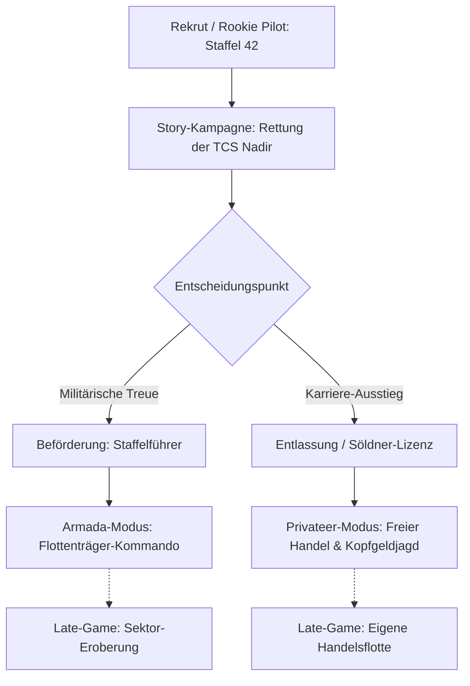

# ARCHITECTURAL BRIEFING & ROADMAP: SOLO WING (WINGNUT HYBRID)
**Target Model:** Claude Opus 5.5 (Head Architect / Master Integrator)
**Project:** `solo_wing_1990` -> `Solo Wing: Wingnut Armada` (Open-World Roguelike Raumjäger- & Trägersimulation)
**Stand:** November 2026 | Arbeitsverzeichnis: `G:\AgentHome\solo_wing_1990`

---

## 1. Executive Summary & Core Directive

Dieses Dokument definiert die Architektur, den historischen Kontext und die operative Roadmap zur Verschmelzung des bisherigen Retro-Spiels `solo_wing_1990` mit der neuen **Wingnut 544-Frame Flight Engine**, dem **Armada-Flottenmodell** und der **Privateer-1-Handels-ökonomie**.

### Die Goldene Regel: Kein Feature Creep!
> [!IMPORTANT]
> **Anti-Star-Citizen-Prinzip:** Keine überkomplexen Newtonschen Orbitalmechaniken, keine zahllosen halbfertigen Systeme. Wir folgen der Eleganz von *Wing Commander: Armada* (1994) und *Privateer 1* (1993): 
> Ein überschaubarer, taktisch tiefer Core-Loop, griffiges Hangar-/Staffel-Interface und charmante Narrative (die "Eisernen Faxe", Jamming-Notfall-Fax, Crew-Chatter).

---

## 2. Historische Benchmark-Analyse (Best Practices & Lessons Learned)

| Projekt / Vorbild | Was wir übernehmen | Was wir vermeiden |
| :--- | :--- | :--- |
| **Wing Commander 1 & 2** *(Origin 1990-1992)* | Dramatische Kampagnen-Struktur (Winning/Losing Track), Bar-Gespräche, Piloten-Persönlichkeiten, MFD-Cockpit-Layout, Beerdigungs-/Medaillen-Szenen. | Starre lineare Skripte ohne Wiederspielwert; unfaire Sofort-Tode ohne taktischen Rückzug. |
| **Wing Commander: Armada** *(Origin 1994)* | Sektor-Knoten-Karte (16 Sektoren), Träger-Versorgung (Treibstoff, Reparaturen), Jäger-Staffel-Zuweisung, 4-Komponenten-Schadensmodell (Hülle, Schilde, Triebwerk, Laser). | Tastatur-Kollisionsbugs alter DOS-Tage; fehlender Story-Tiefgang außerhalb des MP-Matches. |
| **Privateer 1** *(Origin 1993)* | Karriere-Ausstieg: Handel mit Basen, Rohstoff-Frachter, modulare Schiffs-Upgrades (Triebwerke, Waffen, Generatoren), Gilden-Terminals. | Zähe Langstreckenflüge ohne Autopilot-Ereignisse; Grind für Basis-Ausrüstung. |
| **Escape Velocity / EV Nova** *(Ambrosia 2002)* | Perfektes Belohnungsgefühl bei Schiffsupgrades und Flottenausbau; klare Fraktionsbeziehungen. | Reine 2D-Draufsicht (wir wollen das immersive 2.5D Cockpit-Gefühl). |
| **Fan-Projekte (Gemini Gold, WCR_GL, WC1-RE)** | Saubere BYOA-Trennung (Bring Your Own Assets); C-Core mit austauschbarem Frontend (SDL2 / WebGL). | Überdimensionierte Render-Pipelines, die alte Hardware (oder Web-Performance) überfordern. |

---

## 3. Die zwei Karriere-Pfade (Dual-Progression)



1. **Der Militärische Pfad (Armada-Modus):**
   - Start auf der *TCS Nadir*. Befehle kommen vom Commander / Admiral.
   - Nach erfolgreichen Kampagneneinsätzen: Beförderung zum Staffelführer (eigene Staffel-Zusammenstellung via [`squadron.js`](file:///G:/AgentHome/solo_wing_1990/js/squadron.js)).
   - Endgame: Volle strategische Kontrolle über die Sektorkarte und Versorgungs-Frachter (Armada-Loop).

2. **Der Freie Pfad (Privateer-1-Modus):**
   - Nach Akt 1 kann der Spieler unehrenhaft oder freiwillig den Dienst quittieren (oder bei Zerstörung der Nadir als Überlebender mit einem alten Jäger stranden).
   - Zugang zu unabhängigen Raumstationen, Minenkolonien und Bars.
   - Freie Missionswahl am Gilden-Terminal, Frachtraum-Ausbau, Handel mit seltenen Teilen.

---

## 4. Technische Architektur: 3-Ebenen-Design

```mermaid
graph TD
    subgraph Presentation_Layer [Präsentations-Ebene (Frontend)]
        WebGL[Three.js / WebGL / Canvas 2D]
        CRT[CRT Phosphor & Scanline Shader]
        Cockpit[Hornet Cockpit MFDs & Joystick Animations]
        Audio[WebAudio Synth + Paula DMA MOD Player]
    end

    subgraph Simulation_Core [Simulations-Kern (Plattform-unabhängig)]
        FlightFSM[Flight Physics & 16.16 Fixed Point Math]
        DogfightAI[AI FSM: Brains.c Port & Wingman Orders]
        ArmadaSim[Sector Graph, Resources & Economy Engine]
    end

    subgraph Data_Lore_Layer [Daten- & Content-Ebene]
        Lore[Crew, Postings, Fax-Tragödie, Dialogues]
        BYOA[Steam / GOG Importer & Fallbacks]
        Assets[544-Frame Sprite Atlanten Howard Day & Arne]
    end

    Presentation_Layer --> Simulation_Core
    Simulation_Core --> Data_Lore_Layer
```

### Modularer Code-Bestand (bereits implementiert auf G:):
* [`js/squadron.js`](file:///G:/AgentHome/solo_wing_1990/js/squadron.js): Staffel 42 Datenmodell, 4-Zonen-Schadensmodell (Hülle, Schilde, Antrieb, Waffen), Pilotenzuweisung.
* [`js/carrier_economy.js`](file:///G:/AgentHome/solo_wing_1990/js/carrier_economy.js): 3-Stufen-Wirtschaft (Pilot, Commander, Admiral), Rohstoffe (Treibstoff, Teile, Rationen, Faxpapier).
* [`js/holo_chat.js`](file:///G:/AgentHome/solo_wing_1990/js/holo_chat.js): IRC-Terminal im Pilotenquartier (`#staffel-42`, `#flotten-intel`, `#technik`) mit Notfall-Fax-Fallback bei ECM-Jamming.
* [`js/byoa_bridge.js`](file:///G:/AgentHome/solo_wing_1990/js/byoa_bridge.js): Lizenzsicherer Importer für originale Steam/GOG-Spieldateien (FMV, .mod Audio).
* [`prototype_wingnut/prototype.js`](file:///G:/AgentHome/solo_wing_1990/prototype_wingnut/prototype.js): 544-Winkel-Sprite-Picker (16 Pitch-Stufen à 32 Azimut-Winkel), Hornet-Cockpit, MFD-HUD, G-Force-Tilt.

---

## 5. Vorbereitung für Retro-Hardware (Amiga 1200 AGA Spec)

Um den späteren Export auf Amiga AGA Hardware (insbesondere das kommende "The A1200") sicherzustellen:
1. **Fixed-Point Mathematik:** Alle Vektor- und Physikrechnungen basieren logisch auf 16.16 Fixed-Point (`fixed_t`). Keine Fließkommazahlen in der Kern-Spiellogik.
2. **4-Kanal Paula DMA Audio:** Soundtracks liegen nativ als Amiga `.mod`-Module vor (0% CPU-Belastung auf Retro-Chips).
3. **Renderer-Abstraktion:** Die Spiellogik (`update()`) weiß nichts vom WebGL/Canvas-Kontext. Ein späterer C-Port mit Scorpion Engine oder AGA Blitter-Skalierung ist dadurch 1:1 möglich.

---

## 6. Operative Aufgaben für Claude Opus 5.5

1. **Integration der Story-Szenen in die neue Engine:**
   - Die Briefing- und Bar-Räume ([`data/rooms.js`](file:///G:/AgentHome/solo_wing_1990/data/rooms.js)) nahtlos mit den neuen Wingnut-Grafiken verknüpfen.
   - Die Fax-Tragödie (Akte 99-Z) als interaktiven Plot-Trigger im Dogfight verankern (wenn Jamming aktiv -> Pilot muss das analoge Cockpit-Fax bedienen).
2. **Three.js Beleuchtungs-Pass:**
   - Dynamisches Punktlicht für Mündungsfeuer (Laserblitze erhellen das Hornet-Cockpit und die Dralthi-Hülle mit Normal-Maps).
3. **Armada-Sektorkarte:**
   - Einfaches 16-Knoten-Diagramm mit Jump-Lines zwischen den Sektoren, Nebeln und feindlichen Flotten.

*Dokumentation vollständig hinterlegt in `G:\AgentHome\solo_wing_1990\docs\`.*
